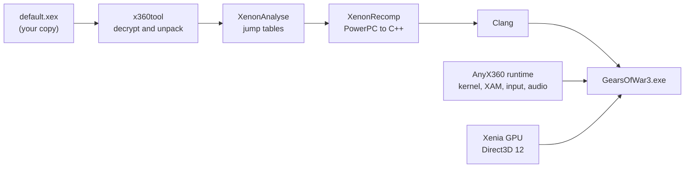

<div align="center">

# AnyX360

**An unofficial, fan-made project that ports Xbox 360 games natively to PC through static recompilation.**

[](#legal-and-disclaimer)
[](CHANGELOG.md)
[](#system-requirements)
[](#how-it-works)
[](#building)
[](#known-issues)

[Installation](#installation) · [Features](#features) · [Controls](#controls) ·
[System Requirements](#system-requirements) · [Building](#building) · [Changelog](CHANGELOG.md)

</div>

> [!CAUTION]
> **AnyX360 is an unofficial fan project.** It is not affiliated with, authorized, sponsored or
> endorsed by Microsoft, Xbox Game Studios, The Coalition, Epic Games, Harmonix or any other rights
> holder.
> It contains **no game code, assets or files**: you must own a legally acquired copy of the game,
> and you provide its files yourself.

AnyX360 translates an Xbox 360 game's PowerPC code ahead of time into C++, compiles it with Clang
and runs it on a runtime that reimplements the console's operating system, input, audio and GPU.
There is no emulator at runtime. The result is a native Windows executable with modern display
options, keyboard and mouse support, local split screen and, for Kinect games, a webcam in place of
the sensor.

**Games:**

- **Gears of War 3**: an unofficial native PC port with campaign, private Horde and local split
  screen at 60 FPS.
- **Dance Central 3** (in testing): the Kinect dance game, played with a webcam. A pose estimator
  turns the webcam's image into the Kinect's skeletons, color image and depth image.

<!-- Screenshot: add docs/images/gow3.png and uncomment.

-->

## Installation

1. Download the release from [Releases](https://github.com/danielbarretoes/AnyX360/releases):
   `AnyX360-<version>.zip`. One release has every game.
2. Extract it to a regular folder (not inside _Program Files_), on a drive with room for the games
   you add from an archive: about 8 GB for Gears of War 3, 7 GB for Dance Central 3.
3. Run **`AnyX360.exe`** and accept the terms of use.
4. Click **Add game…** (or the **+** tile) and choose where your copy of the disc is:
   - **From an archive** (.7z, .rar or .zip): the launcher extracts it into its `games` folder. It
     finds the game inside whatever folders the archive has.
   - **From a game folder**: the launcher uses the folder that contains `default.xex` where it is.

   The launcher recognises the game by its title ID and checks the copy is complete. Add each
   game you have the same way: they appear in the gallery with the game's own icon.
5. Choose a game and click **Play**.

Settings can be changed while playing in the **F2** panel. They are saved to
`%LOCALAPPDATA%\AnyX360\<game>\settings.toml`, next to your saves. The release's `README.txt`
explains each game's controls and how to set up the webcam for Dance Central 3.

> [!NOTE]
> Release packages contain no game data. The game files always come from your own copy.

> [!TIP]
> If Windows SmartScreen says _"Windows protected your PC"_, click **More info → Run anyway**: the
> executables are not digitally signed.

## Features

### Display

- **Window Size** - 720p, 1080p, 1440p or 4K, sized in physical pixels and fitted to the screen.
- **Fullscreen** - Borderless fullscreen, toggled with F11 or Alt+Enter.
- **Render Scale** - Renders at 1x, 2x or 3x the console's 1280x720. Changing it needs a restart,
  which the settings panel does for you.
- **Upscaling** - AMD FidelityFX Super Resolution (FSR), Contrast Adaptive Sharpening (CAS) or
  bilinear.
- **FXAA** - Fast approximate antialiasing on the final image.
- **Frame Rate** - 60 FPS (twice the console's 30) or 30 FPS, switchable while playing.
- **V-Sync** - Presents on the display's refresh: no tearing in fullscreen.
- **Display-Locked Frame Pacing** - The game's vertical blank follows your monitor's refresh, so
  every frame stays on screen for the same time on 60 Hz and 120 Hz displays.
- **Performance Overlay** - F1 shows FPS, frame-time and present graphs, VRAM and RAM use.

### Input

- **Keyboard and Mouse** - Gears-style default bindings and raw-input mouse look, with
  sensitivity, aiming sensitivity, inverted look, smoothing and an anti dead zone. Bindings can be
  changed in `settings.toml`.
- **Controllers** - Xbox controllers through XInput, with vibration.
- **Devices per Player** - Choose keyboard and mouse, a specific controller or none for each player.

### Multiplayer

- **Local Split Screen** - Up to four players. Player 2 joins from the main menu, as a guest or
  with their own profile, and gets their own saves.

### General

- **Settings Panel** - F2 opens an in-game panel; changes apply immediately and are saved.
- **Launcher** - One `AnyX360.exe` for every game, in English and Spanish: a gallery of the games
  you added, with each game's dashboard icon (or a cover you choose). It recognises a copy by its
  title ID, extracts disc archives, starts the game without a console, keeps a log per game and
  points you to it if the game closes with an error.
- **Shader Cache** - Shaders and pipelines are cached between runs, so stutter fades after the
  first play.
- **Saves and Profiles** - Stored in `%LOCALAPPDATA%\AnyX360\<game>`, kept across versions.

### Kinect (Dance Central 3)

- **Webcam as the Kinect** - MediaPipe pose estimation turns the webcam's image into Kinect
  skeletons for up to two players. It also makes the Kinect's color and depth images, so the game's
  silhouettes and photos work.
- **Play Space** - The player is placed where a Kinect expects them: centred, 2.3 m away. **Recentre
  on me** sets it again.
- **Kinect Tab** - F2 shows what the camera sees, its frame rate and latency, and lets you pick the
  webcam and change mirroring, field of view, smoothing, players and the pose model.
- **Mouse Mode** - Without a webcam, the mouse drives the menus: the right hand follows the cursor.
- **Private** - The webcam's images are processed on your computer in real time, and never saved
  or sent.

### What Works

| Mode                             | Status                                         |
| -------------------------------- | ---------------------------------------------- |
| Campaign                         | ✅ Playable                                    |
| Private Horde                    | ✅ Playable                                    |
| Local split screen (2-4 players) | ✅ Playable                                    |
| Online (Xbox Live, Versus)       | ❌ Not available: Xbox 360's Xbox Live is gone |

| Dance Central 3                  | Status                                         |
| -------------------------------- | ---------------------------------------------- |
| Menus (Kinect gestures, mouse)   | ✅ Working                                     |
| Perform and Rehearse songs       | ✅ Playable; scoring follows the moves         |
| Webcam tracking                  | 🧪 In testing                                  |
| Two players                      | 🧪 In testing                                  |
| Voice commands                   | ❌ Not available: no microphone support        |

## Controls

### Gears of War 3

| Action                   | Keyboard and mouse             | Controller         |
| ------------------------ | ------------------------------ | ------------------ |
| Move / Look              | W A S D / Mouse                | Left / right stick |
| Aim / Fire               | Right / left mouse button      | LT / RT            |
| Cover, roadie run, evade | Space (also Left Shift, Enter) | A                  |
| Melee, chainsaw          | V (also Backspace)             | B                  |
| Use, pick up, revive     | E                              | X                  |
| Point of interest        | F                              | Y                  |
| Reload                   | R                              | RB                 |
| Tac-Com                  | Q                              | LB                 |
| Switch weapon            | Arrows, 1-4, mouse wheel       | D-pad              |
| Scope zoom               | Middle mouse button            | RS (click)         |
| Pause / Scoreboard       | Esc / Tab                      | Start / Back       |

### Dance Central 3

| Action                   | Gesture                                                      |
| ------------------------ | ------------------------------------------------------------ |
| Point at a menu item     | Right arm out to the side; move the hand up and down         |
| Select                   | Swipe the arm across your body                               |
| "Left hand" items (back) | The same with the left arm                                   |
| Pause during a song      | Right arm up at 45°, as the game shows; or a controller's Start |

### Program Keys

| Key                      | Action                         |
| ------------------------ | ------------------------------ |
| **F1**                   | Performance overlay            |
| **F2**                   | Settings panel (Esc closes it) |
| **F11** or **Alt+Enter** | Fullscreen                     |
| **Alt+Tab**              | Releases the mouse             |

## Known Issues

Gears of War 3:

- Cinematics and videos run at 30 FPS, as in the original game.
- In Horde, the counter before the first wave can stay at 0:30.
- The game can occasionally crash while loading a Horde map.

Dance Central 3:

- A webcam has no depth camera: turning your back to it, very fast moves and two overlapping
  players can be misread, and there is a little more latency than with a Kinect.
- The pause gesture hasn't been confirmed with a webcam yet; a controller's Start pauses.
- Voice commands don't work.

Found something else? Open an issue with the version (shown in the launcher) and the game's
`logs\<game>\last_run.log` file.

## System Requirements

### Minimum

- **OS**
  - Windows 10 64-bit
- **CPU** with AVX support
  - Intel Sandy Bridge (2nd-generation Core) or newer
  - AMD Bulldozer (FX series) or newer
- **GPU** with Direct3D 12 support (feature level 11_0) and up-to-date drivers
- **Storage**
  - About 8 GB for the game files, plus saves and the shader cache
- **For Dance Central 3**
  - A webcam, 720p at 30 FPS or better
  - A 4-core CPU: the pose estimation runs on it
  - 2-3 m of clear space in front of the webcam

### Tested On

- Windows 11 Pro, NVIDIA GeForce RTX 5060 Laptop GPU: 60 FPS in campaign and Horde at 1080p output
  (1x render scale with FSR).

## Building

### 1. Clone the Repository

Clone this repository with its submodules using [Git](https://git-scm.com/).

```
git clone --recursive https://github.com/danielbarretoes/AnyX360.git
```

### 2. Install Dependencies

Install [Visual Studio 2022](https://visualstudio.microsoft.com/downloads/) or later with these
**Workloads** and **Individual components**:

- Desktop development with C++
- C++ Clang tools for Windows
- C++ CMake tools for Windows

Also install [7-Zip](https://www.7-zip.org/), to extract the game and to package releases, and
Python 3 with `cryptography`, needed only for the tests. The webcam pose bridge needs
[Python 3.14](https://www.python.org/downloads/); its build script makes its own virtual
environment with pinned, hash-checked packages.

### 3. Add the Required Game Files

- Gears of War 3: put the `.7z` of your disc in `Raw/` and extract it to `extracted/gow3/`.
- Dance Central 3: copy its `default.xex` to `extracted/dc3/` and make `extracted/dc3/game` a
  directory junction to your disc folder (see [docs/DANCECENTRAL3.md](docs/DANCECENTRAL3.md#reproducing)).
- Put the XEX2 retail key in `keys/xex2_retail.key` (see [keys/README.md](keys/README.md)).

Both folders are git-ignored.

> [!IMPORTANT]
> The targets are the base disc executables, without title updates: Gears of War 3 (title
> `4D5308AB`) and Dance Central 3 (title `373307D9`).

### 4. Recompile the Game

Build the tools, analyse the executable and generate the C++ sources in the folder `config.toml`
names. The exact commands are in [docs/GEARS3.md](docs/GEARS3.md#reproducing-from-the-7z-in-raw) and
[docs/DANCECENTRAL3.md](docs/DANCECENTRAL3.md#reproducing). For Gears of War 3:

```bat
build.bat
cd games\gow3
..\..\build\thirdparty\XenonRecomp\XenonAnalyse\Release\XenonAnalyse.exe "..\..\extracted\gow3\Gears Of War 3\AP7kB\default.xex" switch_tables.toml
..\..\build\thirdparty\XenonRecomp\XenonRecomp\Release\XenonRecomp.exe config.toml ..\..\thirdparty\XenonRecomp\XenonUtils\ppc_context.h
```

> [!WARNING]
> Regenerate into an empty `recomp/` folder: XenonRecomp doesn't delete files from an earlier run,
> and stale ones break the link.

### 5. Build the Project

- Run `build.bat` again. The first build compiles the whole recompiled game and takes a while.
- When it finishes, run `build\games\gow3\Release\GearsOfWar3.exe` (or
  `build\games\dc3\Release\DanceCentral3.exe`). It finds `extracted/` and `keys/` on its own, or
  use `--game` and `--key`. The launcher, `build\launcher\Release\AnyX360.exe`, also runs from the
  build folder and finds the games there.
- For Dance Central 3's webcam, build the pose bridge:
  `powershell -ExecutionPolicy Bypass -File tools\pose_bridge\build_bridge.ps1` (see
  [tools/pose_bridge](tools/pose_bridge/README.md)).
- Optionally, package a release with the launcher and every game built:
  `powershell -ExecutionPolicy Bypass -File tools\package\make_dist.ps1`.

## How It Works



- **Recompilation** - Forks of [XenonRecomp](https://github.com/hedge-dev/XenonRecomp) and
  XenonAnalyse translate every function of the executable into C++. They add jump-table detection,
  function bounds and the instructions this game needs.
- **Runtime** - AnyX360 reimplements the `xboxkrnl` and `xam` exports the game calls: memory,
  threads and synchronization, files, profiles and saves, notifications, and local networking. It
  also provides input, settings and the launcher.
- **GPU and Audio** - The game's Direct3D command stream is rendered by
  [Xenia](https://github.com/xenia-canary/xenia-canary)'s Direct3D 12 back end. XMA audio is decoded
  by Xenia's decoder and played through XAudio2.
- **Kinect** - The Kinect library linked into the game is replaced at its API by a virtual sensor.
  Its skeletons and images come from the pose bridge, a Python program that runs
  [MediaPipe](https://ai.google.dev/edge/mediapipe) on the webcam, or from the mouse.

More in [docs/ARCHITECTURE.md](docs/ARCHITECTURE.md), [docs/GEARS3.md](docs/GEARS3.md),
[docs/DANCECENTRAL3.md](docs/DANCECENTRAL3.md) and [docs/ROADMAP.md](docs/ROADMAP.md).

## Versioning

AnyX360 follows [Semantic Versioning](https://semver.org). The version is in [VERSION](VERSION).
Builds append the git commit as build metadata (`0.1.0+0b3cb8d`, plus `.dirty` with uncommitted
changes). That full version appears in the launcher, the game's log, the F2 panel and the
executables' file properties. Each release is tagged `v<version>` and described in
[CHANGELOG.md](CHANGELOG.md), following
[Keep a Changelog](https://keepachangelog.com/en/1.1.0/).

To release a version:

1. Move the _Unreleased_ entries to a new version section in the changelog.
2. Update `VERSION`.
3. Commit and tag `v<version>`.
4. Run `tools\package\make_dist.ps1`. It names the release after the tag, without build metadata.

## Tools

`x360tool` (in `build\tools\x360tool\Release\`):

| Command                                 | What it does                                                                      |
| --------------------------------------- | --------------------------------------------------------------------------------- |
| `iso-info <image>`                      | Detects the layout (xiso, XGD2, XGD3) and counts the files                        |
| `iso-list <image>`                      | Lists every file in the game partition                                            |
| `iso-extract <image> <dir> [paths…]`    | Extracts all files, or only the given ones                                        |
| `xex-info <xex>`                        | Headers, title ID, version, compression, imports, XDK libraries, page map         |
| `xex-extract <xex> <out.bin> [--key f]` | Decrypts and decompresses the PE image; writes `.imports.txt` and `.sections.txt` |
| `xex-icon <xex> <out.png> [--key f]`    | Writes the title image: the dashboard icon the launcher shows                     |

## Project Layout

```
docs/             Architecture, roadmap, format notes, per-game notes
games/gow3/       Gears of War 3: recompiler config, entry point, game-specific hooks
games/dc3/        Dance Central 3: recompiler config, entry point, Kinect bindings, notes
runtime/          Kernel and XAM reimplementation, input, settings, GPU and audio glue,
                  and the virtual Kinect (runtime/src/nui)
tools/x360tool/   Disc and XEX tooling
tools/launcher/   Windows launcher with the games' gallery (English and Spanish) and its terms of use
tools/package/    Release packaging: the release's README and each game's section
tools/pose_bridge/ The webcam pose bridge (Python, MediaPipe) and its build
tools/scripts/    Analysis helpers (frame timing, switch helpers, NUI reconnaissance)
tests/            Synthetic tests (no game data, no camera)
thirdparty/      XenonRecomp, XenosRecomp and Xenia forks, and other dependencies
Raw/, extracted/ Your game files (git-ignored)
```

## Legal and Disclaimer

- **AnyX360 is an unofficial, independent, non-commercial fan project.** It is not affiliated with,
  authorized, sponsored or endorsed by Microsoft, Xbox Game Studios, The Coalition, Epic Games,
  Harmonix or any other rights holder, and it is not an official product or port of any game.
- This repository contains **no game code, assets or console keys**, and never will. The
  third-party XenonRecomp submodule (like Xenia) embeds the publicly known XEX2 retail key in its
  source to load executables; AnyX360's own tools read the key from `keys/` instead.
- You need your own legally obtained copy of the game. Disc images go in `Raw/`, which is
  git-ignored along with `*.iso`, `*.xex`, `extracted/`, `keys/` and all recompiler output, which
  is derived from the game's code.
- Release packages contain no game data and are covered by the [terms of use](tools/launcher/terms_en.txt)
  the launcher shows before first use.
- Gears of War, Dance Central, Harmonix, Kinect, Xbox and Xbox 360 are trademarks of their
  respective owners, used here only to identify the games AnyX360 is compatible with.
- Rights holders can reach the developer through this repository's issues to request a review.

## Credits

- [XenonRecomp](https://github.com/hedge-dev/XenonRecomp) by hedge-dev, the static recompiler at
  the core of this project, and [UnleashedRecomp](https://github.com/hedge-dev/UnleashedRecomp),
  which proved the approach.
- [Xenia](https://github.com/xenia-canary/xenia-canary), for its Direct3D 12 GPU back end, XMA
  decoder and UI code.
- [BLACK-XBERecomp](https://github.com/danielbarretoes/BLACK-XBERecomp) and
  [AnyPS5](https://github.com/boykopovar/AnyPS5), which inspired this project.
- [MediaPipe](https://ai.google.dev/edge/mediapipe), [OpenCV](https://opencv.org/),
  [NumPy](https://numpy.org/) and [PyInstaller](https://pyinstaller.org/), behind the webcam pose
  bridge.
- [AMD FidelityFX](https://gpuopen.com/fidelityfx-superresolution/), [Dear ImGui](https://github.com/ocornut/imgui),
  [FFmpeg](https://ffmpeg.org/), [7-Zip](https://www.7-zip.org/) and the other libraries listed in
  the release's `licenses` folder.

<div align="center">

**Unofficial fan project** · Developed by **danbadev-es**

</div>
