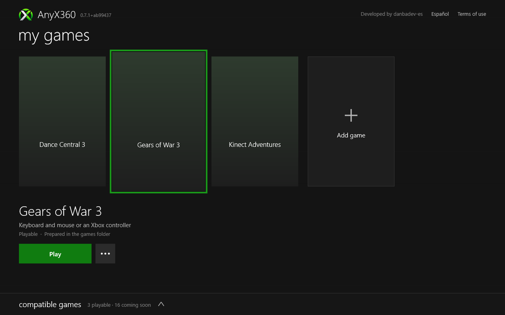
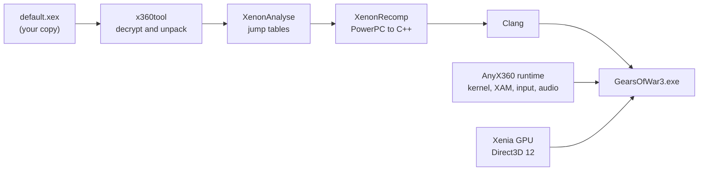

<div align="center">

# AnyX360

**An unofficial, fan-made project that ports Xbox 360 games natively to PC through static recompilation.**

[](#legal-and-disclaimer)
[](CHANGELOG.md)
[](#system-requirements)
[](#how-it-works)
[](#building)
[](#known-issues)

[Installation](#installation) · [Features](#features) · [Controls](#controls) ·
[System Requirements](#system-requirements) · [Building](#building) · [Changelog](CHANGELOG.md)

</div>

> [!CAUTION]
> **AnyX360 is an unofficial fan project.** It is not affiliated with, authorized, sponsored or
> endorsed by Microsoft, Xbox Game Studios, The Coalition, Epic Games, Harmonix, Good Science Studio,
> Halfbrick Studios, Rare, Behaviour Interactive, Frito-Lay, Activision, Infinity Ward, Sledgehammer
> Games, Treyarch, Capcom, Mojang, 4J Studios or any other rights holder.
> It contains **no game code, assets or files**: you must own a legally acquired copy of the game,
> and you provide its files yourself.

AnyX360 translates an Xbox 360 game's PowerPC code ahead of time into C++, compiles it with Clang
and runs it on a runtime that reimplements the console's operating system, input, audio and GPU.
There is no emulator at runtime. The result is a native Windows executable with modern display
options, keyboard and mouse support, local split screen and, for Kinect games, a webcam in place of
the sensor.

**Games:**

- **Gears of War 3**: an unofficial native PC port with campaign, private Horde and local split
  screen at 60 FPS.
- **Dance Central 3** (in testing): the Kinect dance game, played with a webcam. A pose estimator
  turns the webcam's image into the Kinect's skeletons, color image and depth image.
- **Kinect Adventures** (in testing): the game that came with the Kinect, played with the same
  webcam, from a Games on Demand copy with its downloadable content and its title update (version
  0.0.1.3).
- **Fruit Ninja Kinect** (in testing): the Xbox Live Arcade game, slicing fruit with your hands in
  front of the webcam, with its downloadable content and its title update (version 0.0.1.3).
- **Doritos Crash Course** (in testing): the Xbox Live Arcade obstacle race with a controller, where
  everyone is an Xbox Avatar, with its title update (version 0.0.2.2).
- **Kinect Sports** (in testing): Rare's six sports, played with the webcam, with Xbox Avatars and
  its title update (version 0.0.4.2: the calorie challenge and the new menus).
- **Kinect Joy Ride** (in testing): BigPark's kart racer, steering an imaginary wheel in front of
  the webcam, with Xbox Avatars at the wheel, two players in split screen, its Chevy Volt and
  Chevrolet Car Pack DLC and Title Update #3 (version 0.0.3.1).
- **Call of Duty: Modern Warfare 3** (in testing): the campaign at 60 FPS, with keyboard and mouse
  or a controller, and multiplayer and Special Ops in split screen on one machine, with its title
  update (version 0.0.23.8) and the downloadable maps.
- **Call of Duty: Black Ops II** (in testing): the campaign at 60 FPS, and multiplayer (with bots)
  and Zombies in split screen on one machine, with its title update (version 0.0.18.14) and the
  downloadable maps (Revolution, Uprising, Vengeance, Apocalypse, the Nuketowns).
- **Kinect Party** (in testing): Double Fine's Xbox Live Arcade party game, the webcam's picture
  with you cut out of it in 36 channels of effects, with its Full Unlock.
- **Resident Evil 6** (in testing): Capcom's campaign with one player, at 30 FPS as on the
  console, with keyboard and mouse or a controller, with its title update (version 0.0.6.3) and its
  downloadable content (Siege and the 3-Mode Pack included); the prologue is being played through.
- **Minecraft: Xbox 360 Edition** (in testing): 4J Studios' edition from Xbox Live Arcade with its
  last title update (version 0.0.80.1), new and saved worlds, up to four players in split screen,
  and its downloadable content (skins, texture packs, mash-ups).

Avatar games get their **Xbox Avatars** from the console's avatar data, which the Kinect Sports disc
carries: AnyX360 builds each avatar from it, with the clothes, hair and face the game asks for. Your
own avatar is made in the launcher's avatar editor and plays in every avatar game.



<sub>The launcher (shown without box art: the release has each game's front cover).</sub>

## Installation

1. Download the release from [Releases](https://github.com/danielbarretoes/AnyX360/releases):
   `AnyX360-<version>.zip`. One release has every game.
2. Extract it to a regular folder (not inside _Program Files_), on a drive with room for the games
   you add from an archive: about 8 GB for Gears of War 3, 7 GB for Dance Central 3, 8 GB for
   Kinect Adventures, 1 GB for Fruit Ninja Kinect, 1 GB for Doritos Crash Course, 4 GB for
   Kinect Sports, 8 GB for Call of Duty: Modern Warfare 3, 8 GB for Call of Duty: Black Ops II,
   2 GB for Kinect Joy Ride, 1 GB for Kinect Party, 8 GB for Resident Evil 6 (3 GB more for its
   downloadable content) and 2 GB for Minecraft (1 GB more for its downloadable content).
3. Run **`AnyX360.exe`** and accept the terms of use.
4. Choose **Add game** (the **+** tile), or drop your copy on the window, as you have it:
   - **A file**: an archive of any kind (.7z, .rar, .zip, split or not, .tar.gz...), a disc image
     (.iso), or a Games on Demand or Xbox Live Arcade package. It is extracted or written out into
     the launcher's `games` folder; you can delete the original afterwards. A password-protected
     archive asks for its password.
   - **A folder** with the disc's files: it is used where it is.
   - **An AnyX360 backup** (.anyx), saved earlier with **Save as .anyx…**: the game goes back as it
     was saved, with its downloadable content, checked file by file and without converting
     anything.

   The launcher recognises the game by its content, its title ID and its version (the one AnyX360
   was recompiled from: an update or a re-release under the same title ID is refused) and checks the
   copy is complete. The game's downloadable content in the copy is installed too; other games'
   content is left out. Add each game you have the same way: it appears with its box art.

   **Title updates.** A game AnyX360 plays with its title update (Kinect Adventures, Fruit Ninja
   Kinect, Doritos Crash Course, Kinect Sports, Kinect Joy Ride, Resident Evil 6, Modern Warfare 3,
   Black Ops II and Minecraft; for the two Call of Duty games, both programs) is
   recompiled from the updated executable: the launcher installs the update from the copy (the
   `TU_…` file, or a `<TitleID>\000B0000\` package) and the game is ready only with it. Its version
   must be the one AnyX360 plays; another is left out. A copy added without it shows "Needs its
   title update": add the update the same way (the same archive, or the `TU_…` file alone). The
   game patches its disc's executable with the update when it starts (cached after the first time)
   and reads the update's files.
5. Choose a game and press **Play**. The launcher works with the mouse, the keyboard or an Xbox
   controller. **Console mode** (in the header) makes it a dashboard the game opens in, as one
   window; the Xbox button in a game opens the Guide, with **Xbox Home** back to it.

Settings can be changed while playing in the **F2** panel. They are saved to
`%LOCALAPPDATA%\AnyX360\<game>\settings.toml`, next to your saves. The release's `README.txt`
explains each game's controls and how to set up the webcam for the Kinect games.

> [!NOTE]
> Release packages contain no game data. The game files always come from your own copy.

> [!TIP]
> If Windows SmartScreen says _"Windows protected your PC"_, click **More info → Run anyway**: the
> executables are not digitally signed.

## Features

### Display

- **Window Size** - 720p, 1080p, 1440p or 4K, sized in physical pixels and fitted to the screen.
- **Fullscreen** - Borderless fullscreen, toggled with F11 or Alt+Enter.
- **Render Scale** - Renders at 1x, 2x or 3x the console's 1280x720. Changing it needs a restart,
  which the settings panel does for you.
- **Upscaling** - AMD FidelityFX Super Resolution (FSR), Contrast Adaptive Sharpening (CAS) or
  bilinear.
- **FXAA** - Fast approximate antialiasing on the final image.
- **Frame Rate** - 60 FPS (twice the console's 30) or 30 FPS, switchable while playing.
- **V-Sync** - Presents on the display's refresh: no tearing in fullscreen.
- **Display-Locked Frame Pacing** - The game's vertical blank follows your monitor's refresh, so
  every frame stays on screen for the same time on 60 Hz and 120 Hz displays.
- **Performance Overlay** - F1 shows FPS, frame-time and present graphs, VRAM and RAM use, and a
  warning when a laptop runs on battery (Windows slows it down: frames and the webcam stall).
- **Sharp at Any Scale** - Per-monitor DPI aware: the window and the panels are drawn at the
  screen's own resolution at 125 %, 150 % or 200 % scaling.

### Input

- **Keyboard and Mouse** - Gears-style default bindings and raw-input mouse look, with
  sensitivity, aiming sensitivity, a response curve (slow movements turn faster), inverted look,
  smoothing and an anti dead zone. The cursor is captured as soon as the game is in front, in a
  window or in fullscreen. Bindings can be changed in `settings.toml`.
- **Controllers** - Xbox controllers through XInput, with vibration.
- **Devices per Player** - Choose keyboard and mouse, a specific controller or none for each player.

### Multiplayer

- **Local Split Screen** - Up to four players. Player 2 joins from the main menu, as a guest or
  with their own profile, and gets their own saves: the game's sign-in screen lists the profiles,
  and each player chooses theirs (or creates one) with their own controller.

### General

- **Settings Panel** - F2 opens an in-game panel (display, controls, players, Kinect,
  performance); changes apply immediately and are saved.
- **Launcher** - One `AnyX360.exe` for every game, in English and Spanish, in the style of the Xbox
  360's last dashboard: your games' box art, a drawer with the compatible and coming games, mouse,
  keyboard and controller. It takes your copy in any format, recognises it by its content, starts
  the game without a console, keeps a log per game and points you to it if the game closes with an
  error.
- **Backups (.anyx)** - The ⋯ menu's **Save as .anyx…** writes a prepared game, with its
  downloadable content and the title update it is played with, into one file (a 7z with a manifest
  of every file and its SHA-256; no saves or keys): **Add game** takes it back, on this PC or another of yours, checked file by
  file and without converting anything. It is a backup of your own copy, not a way to give games to
  others ([docs/ANYX.md](docs/ANYX.md)).
- **Profiles** - Global profiles, as on the console ([docs/PROFILES.md](docs/PROFILES.md)): a
  gamertag, its own saves in every game and its time played. The launcher asks "Who's playing?"
  and manages them (create, rename, delete, the language the games use); in a game the sign-in
  screen is a picker driven by each player's controller, with an on-screen keyboard for a new
  gamertag. The names set before 0.20.0 become profiles with their saves. Each profile has its
  avatar and its gamerpic (a picture of the avatar, or one from your games).
- **Achievements** - Each game's achievements, from its own data (its title update's when it has
  one), unlock for the profile playing, once and with their date
  ([docs/ACHIEVEMENTS.md](docs/ACHIEVEMENTS.md)): a toast at the bottom of the screen with a chime
  (F2 turns them off), the game's own achievements menu lists them, and the launcher has an
  **Achievements** page per game and the profile's gamerscore in the header. Achievements earned on
  a console aren't imported.
- **The Guide** - The Xbox button (or Back and Start held a second, or Home) opens the console's
  menu over the paused game: Resume, Achievements, Profiles (sign players in or out), Settings and
  Xbox Home, back to the dashboard ([docs/DASHBOARD.md](docs/DASHBOARD.md), which also explains
  turning off the Game Bar's use of the button). Toasts say when a controller connects or a player
  signs in.
- **Console mode** - The launcher as a dashboard, borderless in its window or full screen, driven
  by the controller: Home (the game played last, the gamercard), Games, Achievements, Profiles,
  Avatar, Settings and Add a game, changed with LB and RB. Games open in the same place and the
  dashboard comes back when they end, as one window; **Desktop mode** keeps the usual window.
- **Shader Cache** - Shaders and pipelines are cached between runs, so stutter fades after the
  first play.
- **Saves** - Stored in `%LOCALAPPDATA%\AnyX360\<game>` (each profile's in its own folder),
  kept across versions.

### Kinect (Dance Central 3, Kinect Adventures, Fruit Ninja Kinect, Kinect Sports, Kinect Joy Ride, Kinect Party)

- **Webcam as the Kinect** - MediaPipe pose estimation turns the webcam's image into Kinect
  skeletons for up to two players. It also makes the Kinect's color and depth images, so the game's
  silhouettes and photos work.
- **Precise Joints** - Each joint is placed from the image (the pose model's most precise output),
  filtered per joint with a little prediction, and planted feet are held still. The skeleton
  reaches the game as soon as the webcam's frame is processed. Legs the webcam can't see (playing
  close to a laptop) stand still under you instead of following the model's guesses.
- **Where You Are** - The virtual Kinect stands where the webcam is: the camera picture the game
  gets is the webcam's whole image, fixed (no zoom onto you), with your skeleton on it, and the
  floor is where your feet are. **Moved to the Kinect's spot** in F2 places you centred, 2.3 m
  away, for a webcam you can't stand in front of; **Recentre on me** then sets it again.
- **Tilted Webcams** - The tilt is level by default, for a laptop lid turned to face you. A webcam
  pitched down from a monitor can be set by hand, or measured from your body and the floor and
  corrected, so you don't look like you're leaning.
- **Kinect Tab** - F2 shows the image the game gets with your skeleton over it (each joint by how
  sure the tracking is), the frame rate, where the latency goes, and the measured tilt. It picks
  the webcam and changes mirroring, field of view, smoothing, players, the pose model and the tilt.
- **Kinect Guide Gesture** - The left arm held out and down at 45 degrees (the right arm down)
  pauses the game, as on the console, with the Kinect Guide icon filling in the bottom-left corner
  while it is held. The guide stays open at least 3 seconds.
- **Kinect Debug Window** - F3 opens a window of its own, for a second monitor, with everything the
  virtual Kinect sees: the image with every skeleton, the depth image, the play space from above
  and from the side, each joint and the latency over the last 10 seconds.
- **Mouse Mode** - Without a webcam, the mouse drives the menus: the right hand follows the cursor.
- **Private** - The webcam's images are processed on your computer in real time, and never saved
  or sent.

### Xbox Avatars (Doritos Crash Course, Kinect Sports, Kinect Joy Ride)

- **Avatars from the Console's Data** - On the console the avatars' clothes, hair and faces come
  from the system, not from the game. AnyX360 reads the console's avatar asset pack, which the
  Kinect Sports disc carries, and builds each avatar the game asks for: its body shaped to its
  height and weight, its clothes in their colours, its hairstyle, eyes, eyebrows and mouth.
- **Shared** - Adding Kinect Sports installs the pack for every avatar game: Doritos Crash Course,
  which doesn't carry one, gets its avatars from it.
- **Your Avatar** - The launcher's avatar editor (the dashboard's Avatar page, or a profile's menu)
  dresses each profile's avatar with the console's parts, colours and shapes, with the controller,
  beside a 3D view of it; the games then give each player the avatar of the profile signed in on
  their controller ([docs/AVATARS.md](docs/AVATARS.md)).

### What Works

| Mode                             | Status                                         |
| -------------------------------- | ---------------------------------------------- |
| Campaign                         | ✅ Playable                                    |
| Private Horde                    | ✅ Playable                                    |
| Local split screen (2-4 players) | ✅ Playable                                    |
| Online (Xbox Live, Versus)       | ❌ Not available: Xbox 360's Xbox Live is gone |

| Dance Central 3                  | Status                                         |
| -------------------------------- | ---------------------------------------------- |
| Menus (Kinect gestures, mouse)   | ✅ Working                                     |
| Perform and Rehearse songs       | ✅ Playable; scoring follows the moves         |
| Webcam tracking                  | 🧪 In testing                                  |
| Two players                      | 🧪 In testing                                  |
| Voice commands                   | ❌ Not available: no microphone support        |

| Kinect Adventures                | Status                                         |
| -------------------------------- | ---------------------------------------------- |
| Menus (hand cursor)              | ✅ Working                                     |
| Rallyball, River Rush            | ✅ Playable with the scripted player           |
| Reflex Ridge, Space Pop          | 🧪 They load; starting them needs a person     |
| 20,000 Leaks                     | 🧪 Not tried yet                               |
| Downloadable content             | ✅ Installed by the launcher                   |
| Title Update #1 (0.0.1.3)        | ✅ Required: the game is recompiled from it    |
| Avatars, voice, online           | ❌ Not available (the game uses its stand-ins) |

| Fruit Ninja Kinect               | Status                                         |
| -------------------------------- | ---------------------------------------------- |
| Calibration, menus               | ✅ Working (slice a fruit to choose)           |
| Arcade, Classic                  | ✅ Playable with the scripted player           |
| Zen, Party (two players)         | 🧪 Not tried yet                               |
| Progress and best scores         | ✅ Saved                                       |
| Downloadable content             | ✅ Installed by the launcher                   |
| Title update (0.0.1.3)           | ✅ Required: the game is recompiled from it    |
| Leaderboards, avatar awards      | ❌ Not available: they need Xbox Live          |

| Doritos Crash Course             | Status                                         |
| -------------------------------- | ---------------------------------------------- |
| Menus, country and level choice  | ✅ Working with a controller or the keyboard   |
| Levels                           | 🧪 Running, jumping, checkpoints; finishing one not tried yet |
| Avatars (player, crowd)          | ✅ With the avatar data from Kinect Sports     |
| Saving progress                  | ✅ Saved and loaded again                      |
| Title update (0.0.2.2)           | ✅ Required: the game is recompiled from it    |
| Leaderboards                     | ❌ Not available: they need Xbox Live          |

| Kinect Sports                    | Status                                         |
| -------------------------------- | ---------------------------------------------- |
| Menus, picking the main player   | ✅ Working (hand cursor), with the update's new menus |
| Avatars                          | ✅ The game's guests with their looks; you play as your profile's avatar |
| Bowling                          | 🧪 Starts and follows the body; not played through yet |
| Football                         | 🧪 Loads; not played through yet               |
| Other sports, two players        | 🧪 Not tried yet                               |
| Title update (0.0.4.2)           | ✅ Required: the game is recompiled from it    |
| Online, avatar awards            | ❌ Not available: they need Xbox Live          |

| Kinect Joy Ride                  | Status                                         |
| -------------------------------- | ---------------------------------------------- |
| Menus, garage, vehicles, results | ✅ Working (hand cursor), at 30 FPS as on the console |
| Pro Race                         | ✅ Played to the finish with the scripted player: steering, turbo, drifts, tricks |
| Battle Race                      | 🧪 Starts; items not tried yet                 |
| Two players (split screen)       | 🧪 A race played to the finish with two scripted players |
| Stunt, Sprint, Smash, Trick      | 🧪 Offered; not tried yet                      |
| Avatars                          | ✅ The drivers; you drive as your profile's avatar |
| Downloadable content             | ✅ The Chevy Volt and the Chevrolet Car Pack (Camaro, Corvette, Cruze) |
| Title Update #3 (0.0.3.1)        | ✅ Required: the game is recompiled from it    |
| Online, avatar awards            | ❌ Not available: they need Xbox Live          |

| Call of Duty: Modern Warfare 3   | Status                                         |
| -------------------------------- | ---------------------------------------------- |
| Menus, settings, saves           | ✅ Working                                     |
| Campaign                         | 🧪 The opening missions played; the rest not tried yet |
| Special Ops, Survival            | 🧪 Survival played alone and in split screen; the missions not tried yet |
| Multiplayer, split screen        | 🧪 Its own program, started from the main menu and back; split screen matches on Seatown played (two and three players) |
| Downloadable maps                | 🧪 Offered (Game Setup > Map > Bonus maps); a split screen match on Piazza played |
| Title Update (0.0.23.8)          | ✅ Required: both programs are recompiled from it |
| Xbox LIVE, System Link           | ❌ Not available: Xbox LIVE is gone; System Link finds no games |

| Kinect Party                     | Status                                         |
| -------------------------------- | ---------------------------------------------- |
| Start-up, channels on auto play  | ✅ Working (30 FPS)                            |
| The camera picture, the cut-out  | ✅ One or two players cut out; effects follow the body |
| Kung Fu, Monster Attack, Invaders | ✅ Played with the scripted player            |
| Other channels                   | 🧪 Not tried yet                               |
| Channel guide (hub)              | 🧪 START on a controller, then the hand        |
| Full Unlock                      | ✅ Installed by the launcher; every channel opens |
| Voice, photo sharing             | ❌ Not available (no microphones; sharing needs Xbox Live) |

| Call of Duty: Black Ops II       | Status                                         |
| -------------------------------- | ---------------------------------------------- |
| Menus, settings, saves           | ✅ Working                                     |
| Campaign                         | 🧪 The first mission played; the rest not tried yet |
| Multiplayer, split screen        | 🧪 Its own program, started from the main menu and back; Local matches with two to four players and with bots played |
| Zombies, split screen            | 🧪 TranZit alone and with two players, Grief with two played; three or four players not tried yet |
| Downloadable maps                | 🧪 Offered; Magma (Uprising) in split screen and Die Rise (Zombies) with two players played |
| Title Update (0.0.18.14)         | ✅ Required: both programs are recompiled from it |
| Xbox LIVE, System Link           | ❌ Not available: Xbox LIVE is gone; System Link needs a network |

| Resident Evil 6                  | Status                                         |
| -------------------------------- | ---------------------------------------------- |
| Start-up, title, saves           | ✅ Working (30 FPS, as on the console)         |
| Leon's prologue                  | 🧪 Played to the street horde after the alley with the scripted player; its end not yet |
| Main menu, campaigns, Mercenaries | 🧪 Not reached yet (the main menu opens after the prologue) |
| Downloadable content             | ✅ Installed, Siege and the 3-Mode Pack included (their modes are on the main menu, not reached yet) |
| Title Update (0.0.6.3)           | ✅ Required: the game is recompiled from it    |
| Split screen, online             | ❌ Not available (one player; Xbox LIVE is gone) |

| Minecraft: Xbox 360 Edition      | Status                                         |
| -------------------------------- | ---------------------------------------------- |
| Menus, a new world, playing      | ✅ Working (60 FPS with one player)            |
| Saving and loading worlds        | ✅ Saved, listed with its name and seed, loaded again |
| Split screen (two to four players) | ✅ Each new player presses START twice in a game; all four moved, mined and built |
| Downloadable content             | 🧪 Installed by the launcher, all 92 packs load; the Skyrim mash-up played, the other packs not tried one by one |
| Title update (0.0.80.1)          | ✅ Required: the game is recompiled from it    |
| World pictures in the Load list  | ❌ Black                                       |
| Online games, store, leaderboards | ❌ Not available: they need Xbox Live         |

## Controls

### Gears of War 3

| Action                   | Keyboard and mouse             | Controller         |
| ------------------------ | ------------------------------ | ------------------ |
| Move / Look              | W A S D / Mouse                | Left / right stick |
| Aim / Fire               | Right / left mouse button      | LT / RT            |
| Cover, roadie run, evade | Space (also Left Shift, Enter) | A                  |
| Melee, chainsaw          | V (also Backspace)             | B                  |
| Use, pick up, revive     | E                              | X                  |
| Point of interest        | F                              | Y                  |
| Reload                   | R                              | RB                 |
| Tac-Com                  | Q                              | LB                 |
| Switch weapon            | Arrows, 1-4, mouse wheel       | D-pad              |
| Scope zoom               | Middle mouse button            | RS (click)         |
| Pause / Scoreboard       | Esc / Tab                      | Start / Back       |

### Dance Central 3

| Action                   | Gesture                                                      |
| ------------------------ | ------------------------------------------------------------ |
| Point at a menu item     | Right arm out to the side; move the hand up and down         |
| Select                   | Swipe the arm across your body                               |
| "Left hand" items (back) | The same with the left arm                                   |
| Pause during a song      | Left arm out and down at 45° for a moment (the Kinect Guide gesture); or a controller's Start |

### Kinect Adventures

| Action               | Gesture                                                          |
| -------------------- | ---------------------------------------------------------------- |
| Point at an item     | Raise a hand: the cursor follows it                              |
| Select               | Hold the hand over the item until the circle fills               |
| Play                 | Your whole body: jump, duck, lean and step, as each activity shows |
| Pause                | Left arm out and down at 45° for a moment (the Kinect Guide gesture) |

### Fruit Ninja Kinect

| Action               | Gesture                                                          |
| -------------------- | ---------------------------------------------------------------- |
| Slice                | Swipe a hand through the fruit: both hands are blades            |
| Choose a menu item   | Slice its fruit                                                  |
| Kinect Tuner         | Y on a controller                                                |
| Pause                | Left arm out and down at 45° for a moment (the Kinect Guide gesture) |

### Kinect Party

| Action                   | Gesture                                                          |
| ------------------------ | ---------------------------------------------------------------- |
| Play                     | Move: each channel puts its effects on you                       |
| Open the channel guide   | START on a controller                                            |
| Choose a channel         | Raise a hand, hold it on an arrow to scroll, on a stagehand to tune in |

### Doritos Crash Course

| Action                   | Keyboard                       | Controller         |
| ------------------------ | ------------------------------ | ------------------ |
| Run                      | A / D                          | Left stick         |
| Jump                     | Space (also Left Shift, Enter) | A                  |
| Skip ahead when stuck    | R                              | RB                 |
| Back (menus)             | V (also Backspace)             | B                  |
| Pause                    | Esc                            | Start              |

### Call of Duty: Modern Warfare 3

The keyboard and mouse stand in for a controller, as in Gears of War 3. In split screen
(multiplayer and Special Ops), players 2-4 use controllers: each presses A in their corner of the
sign-in screen to join.

| Action                   | Keyboard and mouse             | Controller         |
| ------------------------ | ------------------------------ | ------------------ |
| Move / Look              | W A S D / Mouse                | Left / right stick |
| Aim / Fire               | Right / left mouse button      | LT / RT            |
| Jump                     | Space (also Left Shift, Enter) | A                  |
| Crouch, prone            | V (also Backspace)             | B                  |
| Reload, use              | E                              | X                  |
| Switch weapon            | F                              | Y                  |
| Tactical / frag grenade  | Q / R                          | LB / RB            |
| Sprint / melee           | C / middle mouse button        | L3 / R3            |
| Pause / objectives       | Esc / Tab                      | Start / Back       |

### Call of Duty: Black Ops II

The same keys as Modern Warfare 3; in split screen (multiplayer and Zombies), players 2-4 use
controllers and press A in the lobby to join. Grenades are tactical (Q, LB) and lethal (R, RB);
E (X) also buys, opens doors and revives in Zombies, and the arrows or 1-4 (D-pad) call in
scorestreaks.

### Resident Evil 6

The same keyboard and mouse as Gears of War 3: right mouse button readies the weapon and the left
fires (or strikes, without the weapon ready).

| Action                    | Keyboard and mouse             | Controller         |
| ------------------------- | ------------------------------ | ------------------ |
| Move / Camera             | W A S D / Mouse                | Left / right stick |
| Ready weapon / Fire       | Right / left mouse button      | LT / RT            |
| Run, action, doors        | Space (also Left Shift, Enter) | A                  |
| Partner action            | V (also Backspace)             | B                  |
| Pick up, reload           | E                              | X                  |
| Item menu (herbs)         | F                              | Y                  |
| Show the way              | Q                              | LB                 |
| Health tablet             | R                              | RB                 |
| Weapons and items         | Arrows, 1-4, mouse wheel       | D-pad              |
| Pause / Options           | Esc / Tab                      | Start / Back       |

### Minecraft: Xbox 360 Edition

The keyboard and mouse stand in for a controller. In split screen players 2-4 use controllers: in
a game, each presses START twice to join (the first press shows "Press START to join").

| Action                    | Keyboard and mouse             | Controller         |
| ------------------------- | ------------------------------ | ------------------ |
| Move / Look               | W A S D / Mouse                | Left / right stick |
| Place, use / Mine, attack | Right / left mouse button      | LT / RT            |
| Jump                      | Space (also Left Shift, Enter) | A                  |
| Drop item                 | V (also Backspace)             | B                  |
| Crafting / Inventory      | E / F                          | X / Y              |
| Change item               | Q / R                          | LB / RB            |
| Sneak                     | Middle mouse button            | RS (click)         |
| Pause                     | Esc                            | Start              |

Dial prompts want their button while the turning needle is inside the coloured arc.

### Kinect Sports

| Action               | Gesture                                                          |
| -------------------- | ---------------------------------------------------------------- |
| Start                | Raise a hand above your head                                     |
| Point at an item     | Raise a hand: the cursor follows it                              |
| Select               | Hold the hand over the item until the circle fills               |
| Play                 | As each sport shows before it starts (bowling: pick up the ball, swing back and forwards) |
| Kinect Tuner         | Y on a controller                                                |
| Pause                | Left arm out and down at 45° for a moment (the Kinect Guide gesture) |

### Kinect Joy Ride

| Action               | Gesture                                                          |
| -------------------- | ---------------------------------------------------------------- |
| Point at an item     | Raise a hand: the cursor follows it                              |
| Select               | Hold the hand over the item until the circle fills               |
| Start a race, steer  | Both hands in front of your chest on an imaginary wheel; turn it |
| Turbo                | Pull your hands back to your chest, then push them forward       |
| Drift / tricks       | Lean into a turn / lean any way while in the air                 |
| Second player joins  | Jump in the lobby                                                |
| Pause                | Left arm out and down at 45° for a moment (the Kinect Guide gesture) |

### Program Keys

| Key                      | Action                         |
| ------------------------ | ------------------------------ |
| **F1**                   | Performance overlay            |
| **F2**                   | Settings panel (Esc closes it) |
| **F3**                   | Kinect debug window (Kinect games) |
| **F11** or **Alt+Enter** | Fullscreen                     |
| **Home**, the **Xbox button**, or **Back+Start** held 1 s | The Guide                 |
| **Alt+Tab**              | Releases the mouse             |

## Known Issues

Gears of War 3:

- Cinematics and videos run at 30 FPS, as in the original game.
- In Horde, the counter before the first wave can stay at 0:30.
- The game can occasionally crash while loading a Horde map.
- On an AMD RX 570 the title screen (before Start) shows an artefact on the skull; the main menu is
  fine. If you see it, send the game's log: it names your GPU, and `docs/GEARS3.md` lists options
  to try in `settings.toml`.

Dance Central 3:

- A webcam has no depth camera: turning your back to it, very fast moves and two overlapping
  players can be misread, and there is a little more latency than with a Kinect.
- Voice commands don't work.

Kinect Adventures:

- Reflex Ridge and Space Pop wait at their start ("grab bars", "flap your arms") for the scripted
  test player; they haven't been tried by a person yet.
- There are no avatars: the game shows its stand-ins.
- Same webcam limits as Dance Central 3.

Fruit Ninja Kinect:

- The calibration doesn't move a camera: frame yourself with the webcam (head and hands in view).
- Zen and Party modes haven't been tried yet.
- Same webcam limits as Dance Central 3.

Kinect Party:

- It runs at 30 FPS.
- The channel guide opens with a controller's START only: on the console voice opened it too, and
  there are no Kinect microphones. Without a controller the channels change on their own.
- At most two people are seen (a Kinect saw six). Only three channels have been tried.
- Same webcam limits as Dance Central 3.

Doritos Crash Course:

- Its avatars come from the Kinect Sports disc: without Kinect Sports added, the player is
  invisible.
- Finishing a level, the downloadable content and multiplayer haven't been tried yet.

Kinect Sports:

- In testing: only the menus, the start of Bowling (before its update) and Football's loading have
  been tried, with the test player.
- You play as your profile's avatar (the default one until you make one in the launcher).
- Same webcam limits as Dance Central 3.

Kinect Joy Ride:

- In testing: the menus, Pro Race, Battle Race's start and a two-player race have been tried with
  the test player; the other activities and a person with a webcam haven't.
- It runs at 30 FPS, as on the console: its clock counts the screen's refreshes, so it can't simply
  run at 60.
- You drive as your profile's avatar (the default one until you make one), whose eyes look half
  closed in the garage.
- Same webcam limits as Dance Central 3.

Call of Duty: Modern Warfare 3:

- About one start in fifteen stays on a black screen after the first frame, and many more while the
  computer is busy (other programs building or running): start the game again.
- Multiplayer is a second program: switching between it and the campaign closes the window and
  opens another, and the launcher closes.
- Split screen matches can run below 60 FPS.
- Only the campaign's opening, split screen matches and Survival have been played; in the intro
  level the snowy trees may look flat white.

Call of Duty: Black Ops II:

- Multiplayer and Zombies are a second program: switching between them and the campaign closes
  the window and opens another, and the launcher closes.
- Split screen can run below 60 FPS: two players at 45-60 in heavy moments of a scripted fight,
  four at about 40-50 on the test machine; in a real two-player Zombies match, with many zombies on
  screen, 25-45. Other programs using the processor or most of the memory lower it a lot (an
  editor's C++ indexer took Windows to 50 GB and the game to under 30 FPS, then out of memory: the
  game now says so in a message and in its log).
- Only the first mission, Local matches (Magma among the downloadable maps), TranZit, Grief and
  Die Rise have been played.

Resident Evil 6:

- In testing: the start, the saves and Leon's prologue up to the street after the alley have been
  played with the test player; the end of the prologue, the main menu and everything after it
  haven't been seen yet.
- Siege Game Mode and the 3-Mode Pack are installed, but their modes (on the main menu) haven't
  been tried.
- It runs at 30 FPS, as on the console, with short stutters the first time an area appears.

Minecraft: Xbox 360 Edition:

- The pictures of the worlds in the Load list are black.
- Split screen is heavier: three or four players can run below 60 FPS, more so on a busy computer.
- Downloadable content added with a launcher before 0.19.0 makes the game close while it starts
  (it finds each pack by its name, which that launcher didn't keep): add the content again.
- Only the Skyrim mash-up of the downloadable content has been played.

Found something else? Open an issue with the version (shown in the launcher) and the game's
`logs\<game>\last_run.log` file.

## System Requirements

### Minimum

- **OS**
  - Windows 10 64-bit
- **CPU** with AVX support
  - Intel Sandy Bridge (2nd-generation Core) or newer
  - AMD Bulldozer (FX series) or newer
- **GPU** with Direct3D 12 support (feature level 11_0) and up-to-date drivers
- **Storage**
  - About 8 GB for the game files, plus saves and the shader cache
- **For the Kinect games**
  - A webcam, 720p at 30 FPS or better
  - A 4-core CPU: the pose estimation runs on it
  - 2-3 m of clear space in front of the webcam

### Tested On

- Windows 11 Pro, NVIDIA GeForce RTX 5060 Laptop GPU: 60 FPS in campaign and Horde at 1080p output
  (1x render scale with FSR).

## Building

### 1. Clone the Repository

Clone this repository with its submodules using [Git](https://git-scm.com/).

```
git clone --recursive https://github.com/danielbarretoes/AnyX360.git
```

### 2. Install Dependencies

Install [Visual Studio 2022](https://visualstudio.microsoft.com/downloads/) or later with these
**Workloads** and **Individual components**:

- Desktop development with C++
- C++ Clang tools for Windows
- C++ CMake tools for Windows

Also install [7-Zip](https://www.7-zip.org/), to extract the game and to package releases, and
Python 3 with `cryptography`, needed only for the tests. The webcam pose bridge needs
[Python 3.14](https://www.python.org/downloads/); its build script makes its own virtual
environment with pinned, hash-checked packages.

### 3. Add the Required Game Files

- Gears of War 3: put the `.7z` of your disc in `Raw/` and extract it to `extracted/gow3/`.
- Dance Central 3: copy its `default.xex` to `extracted/dc3/` and make `extracted/dc3/game` a
  directory junction to your disc folder (see [docs/DANCECENTRAL3.md](docs/DANCECENTRAL3.md#reproducing)).
- Kinect Adventures: extract the Games on Demand package's disc files to `extracted/ka/game/` with
  `x360tool god-extract`, and the title update's `default.xexp` to `extracted/ka/update/` with
  `x360tool stfs-extract` (see [docs/KINECTADVENTURES.md](docs/KINECTADVENTURES.md#reproducing)).
- Fruit Ninja Kinect: extract the Xbox Live Arcade package to `extracted/fnk/game/` with
  `x360tool stfs-extract`, and its title update to `extracted/fnk/update/` (see [docs/FRUITNINJAKINECT.md](docs/FRUITNINJAKINECT.md#reproducing)).
- Doritos Crash Course: the same, to `extracted/dcc/game/` and `extracted/dcc/update/` (see
  [docs/DORITOSCRASHCOURSE.md](docs/DORITOSCRASHCOURSE.md#reproducing)).
- Kinect Sports: extract the Games on Demand package's disc files to `extracted/ks/game/` with
  `x360tool god-extract`, and its title update to `extracted/ks/update/` (see [docs/KINECTSPORTS.md](docs/KINECTSPORTS.md#reproducing)).
- Call of Duty: Modern Warfare 3: the same, to `extracted/mw3/game/`, and its title update to
  `extracted/mw3/update/` (see
  [docs/MODERNWARFARE3.md](docs/MODERNWARFARE3.md#reproducing)).
- Call of Duty: Black Ops II: the same, to `extracted/bo2/game/`, and its title update to
  `extracted/bo2/update/` (see
  [docs/BLACKOPS2.md](docs/BLACKOPS2.md#reproducing)).
- Kinect Joy Ride: the same, to `extracted/kjr/game/`, and its title update to `extracted/kjr/update/` (see
  [docs/KINECTJOYRIDE.md](docs/KINECTJOYRIDE.md#reproducing)).
- Kinect Party: extract the Xbox Live Arcade package to `extracted/kp/game/` with
  `x360tool stfs-extract` (see [docs/KINECTPARTY.md](docs/KINECTPARTY.md#reproducing)).
- Resident Evil 6: extract the Games on Demand package's disc files to `extracted/re6/game/` with
  `x360tool god-extract`, and its title update to `extracted/re6/update/` (see [docs/RESIDENTEVIL6.md](docs/RESIDENTEVIL6.md#reproducing)).
- Minecraft: Xbox 360 Edition: extract the Xbox Live Arcade package to `extracted/minecraft/game/`
  with `x360tool stfs-extract`, and its title update to `extracted/minecraft/update/` (see
  [docs/MINECRAFT.md](docs/MINECRAFT.md#reproducing)).
- Put the XEX2 retail key in `keys/xex2_retail.key` (see [keys/README.md](keys/README.md)).

Both folders are git-ignored.

> [!IMPORTANT]
> The targets are the base executables, patched with their title update for Kinect Adventures (title
> `4D5308ED`, 0.0.0.3 to 0.0.1.3), Fruit Ninja Kinect (title `58410B79`, 0.0.0.3 to 0.0.1.3),
> Doritos Crash Course (title `58410A71`, 0.0.0.2 to 0.0.2.2), Kinect Sports (title `4D5308C9`,
> 0.0.0.2 to 0.0.4.2), Kinect Joy Ride (title `4D53093B`, 0.0.0.1 to 0.0.3.1), Resident Evil 6
> (title `43430819`, 0.0.0.3 to 0.0.6.3), Call of Duty: Modern Warfare 3 (title `415608CB`, 0.0.0.8
> to 0.0.23.8), Call of Duty: Black Ops II (title `415608C3`, 0.0.0.14 to 0.0.18.14) and Minecraft:
> Xbox 360 Edition (title `584111F7`, 0.0.0.1 to 0.0.80.1); for the two Call of Duty games, both the
> single-player `default.xex` and the multiplayer `default_mp.xex`, each with its own `.xexp`.
> Without one for Gears of War 3 (title `4D5308AB`) and Dance Central 3 (title `373307D9`).

### 4. Recompile the Game

Build the tools, analyse the executable and generate the C++ sources in the folder `config.toml`
names. The exact commands are in [docs/GEARS3.md](docs/GEARS3.md#reproducing-from-the-7z-in-raw),
[docs/DANCECENTRAL3.md](docs/DANCECENTRAL3.md#reproducing),
[docs/KINECTADVENTURES.md](docs/KINECTADVENTURES.md#reproducing),
[docs/FRUITNINJAKINECT.md](docs/FRUITNINJAKINECT.md#reproducing),
[docs/DORITOSCRASHCOURSE.md](docs/DORITOSCRASHCOURSE.md#reproducing),
[docs/KINECTSPORTS.md](docs/KINECTSPORTS.md#reproducing),
[docs/MODERNWARFARE3.md](docs/MODERNWARFARE3.md#reproducing),
[docs/BLACKOPS2.md](docs/BLACKOPS2.md#reproducing),
[docs/RESIDENTEVIL6.md](docs/RESIDENTEVIL6.md#reproducing) and
[docs/MINECRAFT.md](docs/MINECRAFT.md#reproducing). For Gears of War 3:

```bat
build.bat
cd games\gow3
..\..\build\thirdparty\XenonRecomp\XenonAnalyse\Release\XenonAnalyse.exe "..\..\extracted\gow3\Gears Of War 3\AP7kB\default.xex" switch_tables.toml
..\..\build\thirdparty\XenonRecomp\XenonRecomp\Release\XenonRecomp.exe config.toml ..\..\thirdparty\XenonRecomp\XenonUtils\ppc_context.h
```

> [!WARNING]
> Regenerate into an empty folder (the one `config.toml` names, which must exist): XenonRecomp
> doesn't delete files from an earlier run, and stale ones break the link.

### 5. Build the Project

- Run `build.bat` again. The first build compiles the whole recompiled game and takes a while.
- When it finishes, run `build\games\gow3\Release\GearsOfWar3.exe` (or
  `build\games\dc3\Release\DanceCentral3.exe`, `build\games\ka\Release\KinectAdventures.exe`,
  `build\games\fnk\Release\FruitNinjaKinect.exe`). It
  finds `extracted/` and `keys/` on its own, or use `--game` and `--key`. The launcher,
  `build\launcher\Release\AnyX360.exe`, also runs from the build folder and finds the games there.
- For the Kinect games' webcam, build the pose bridge:
  `powershell -ExecutionPolicy Bypass -File tools\pose_bridge\build_bridge.ps1` (see
  [tools/pose_bridge](tools/pose_bridge/README.md)).
- Optionally, package a release with the launcher and every game built:
  `powershell -ExecutionPolicy Bypass -File tools\package\make_dist.ps1`.

## How It Works



- **Recompilation** - Forks of [XenonRecomp](https://github.com/hedge-dev/XenonRecomp) and
  XenonAnalyse translate every function of the executable into C++. They add jump-table detection,
  function bounds and the instructions this game needs.
- **Runtime** - AnyX360 reimplements the `xboxkrnl` and `xam` exports the game calls: memory,
  threads and synchronization, files, profiles and saves, notifications, and local networking. It
  also provides input, settings and the launcher.
- **GPU and Audio** - The game's Direct3D command stream is rendered by
  [Xenia](https://github.com/xenia-canary/xenia-canary)'s Direct3D 12 back end. XMA audio is decoded
  by Xenia's decoder and played through XAudio2.
- **Kinect** - The Kinect library linked into the game is replaced at its API by a virtual sensor.
  Its skeletons and images come from the pose bridge, a Python program that runs
  [MediaPipe](https://ai.google.dev/edge/mediapipe) on the webcam, or from the mouse.

More in [docs/ARCHITECTURE.md](docs/ARCHITECTURE.md), [docs/GEARS3.md](docs/GEARS3.md),
[docs/DANCECENTRAL3.md](docs/DANCECENTRAL3.md), [docs/KINECTADVENTURES.md](docs/KINECTADVENTURES.md),
[docs/FRUITNINJAKINECT.md](docs/FRUITNINJAKINECT.md) and [docs/ROADMAP.md](docs/ROADMAP.md).

## Versioning

AnyX360 follows [Semantic Versioning](https://semver.org). The version is in [VERSION](VERSION).
Builds append the git commit as build metadata (`0.1.0+0b3cb8d`, plus `.dirty` with uncommitted
changes). That full version appears in the launcher, the game's log, the F2 panel and the
executables' file properties. Each release is tagged `v<version>` and described in
[CHANGELOG.md](CHANGELOG.md), following
[Keep a Changelog](https://keepachangelog.com/en/1.1.0/).

To release a version:

1. Move the _Unreleased_ entries to a new version section in the changelog.
2. Update `VERSION`.
3. Commit and tag `v<version>`.
4. Run `tools\package\make_dist.ps1`. It names the release after the tag, without build metadata.

## Tools

`x360tool` (in `build\tools\x360tool\Release\`):

| Command                                 | What it does                                                                      |
| --------------------------------------- | --------------------------------------------------------------------------------- |
| `iso-info <image>`                      | Detects the layout (xiso, XGD2, XGD3) and counts the files                        |
| `iso-list <image>`                      | Lists every file in the game partition                                            |
| `iso-extract <image> <dir> [paths…]`    | Extracts all files, or only the given ones                                        |
| `xex-info <xex>`                        | Headers, title ID, version, compression, imports, XDK libraries, page map         |
| `xex-extract <xex> <out.bin> [--key f]` | Decrypts and decompresses the PE image; writes `.imports.txt` and `.sections.txt` |
| `xex-icon <xex> <out.png> [--key f]`    | Writes the title image: the dashboard icon the launcher shows                     |
| `content-info <package>`                | A content package's header (type, title, volume) and its files                    |
| `god-extract <header> <dir> [paths…]`   | Extracts a Games on Demand package's disc files                                   |
| `stfs-extract <package> <dir> [--verify]` | Extracts an STFS package (an arcade game, downloadable content); checks its hashes |

## Project Layout

```
docs/             Architecture, roadmap, format notes, per-game notes
games/gow3/       Gears of War 3: recompiler config, entry point, game-specific hooks
games/dc3/        Dance Central 3: recompiler config, entry point, Kinect bindings, notes
games/ka/         Kinect Adventures: recompiler config, entry point, Kinect bindings, notes
games/fnk/        Fruit Ninja Kinect: recompiler config, entry point, Kinect bindings, notes
games/kp/         Kinect Party: recompiler config, entry point, Kinect bindings, notes
games/minecraft/  Minecraft: Xbox 360 Edition: recompiler config, entry point, notes
runtime/          Kernel and XAM reimplementation, input, settings, GPU and audio glue,
                  the virtual Kinect (runtime/src/nui) and its debug window (runtime/kinect_window)
tools/x360tool/   Disc and XEX tooling
tools/launcher/   The launcher: core/ (its logic, launcher_core) and ui/ (the Direct2D window), terms of use
ui/               Drawing shared by the launcher, x360tool and the Kinect window (Direct2D, WIC)
covers/           The games' box art (git-ignored; the release ships the front covers)
tools/package/    Release packaging: the release's README and each game's section
tools/pose_bridge/ The webcam pose bridge (Python, MediaPipe) and its build
tools/scripts/    Analysis helpers (frame timing, switch helpers, NUI reconnaissance)
tests/            Synthetic tests (no game data, no camera)
thirdparty/      XenonRecomp, XenosRecomp and Xenia forks, and other dependencies
Raw/, extracted/ Your game files (git-ignored)
anyx/            Your .anyx backups (git-ignored)
```

## Legal and Disclaimer

- **AnyX360 is an unofficial, independent, non-commercial fan project.** It is not affiliated with,
  authorized, sponsored or endorsed by Microsoft, Xbox Game Studios, The Coalition, Epic Games,
  Harmonix, Good Science Studio, Halfbrick Studios, Rare, Behaviour Interactive, Frito-Lay,
  Double Fine Productions, Activision, Infinity Ward, Sledgehammer Games, Treyarch, Capcom, Mojang,
  4J Studios or any other rights holder, and it is
  not an official product or port of any game.
- This repository contains **no game code, assets or console keys**, and never will. The
  third-party XenonRecomp submodule (like Xenia) embeds the publicly known XEX2 retail key in its
  source to load executables; AnyX360's own tools read the key from `keys/` instead.
- You need your own legally obtained copy of the game. Disc images go in `Raw/`, which is
  git-ignored along with `*.iso`, `*.xex`, `extracted/`, `keys/` and all recompiler output, which
  is derived from the game's code.
- Release packages contain no game data and are covered by the [terms of use](tools/launcher/terms_en.txt)
  the launcher shows before first use.
- An `.anyx` file is your own copy of a game: keep it as a backup or take it to another PC of
  yours. Giving it to someone else is distributing game files, which the terms of use don't allow:
  each player adds their own copy.
- Gears of War, Dance Central, Harmonix, Kinect, Kinect Adventures, Kinect Sports, Kinect Joy
  Ride, Kinect Party, Double Fine, BigPark, Fruit Ninja, Halfbrick, Doritos, Rare, Call of Duty,
  Modern Warfare, Black Ops, Treyarch, Activision, Resident Evil, Capcom, Minecraft, Mojang, Xbox
  and Xbox 360 are trademarks of their
  respective owners, used here only to identify the games
  AnyX360 is compatible with.
- The box art in the release belongs to its publishers and is shown only to identify the games;
  it is not kept in this repository.
- Rights holders can reach the developer through this repository's issues to request a review.

## Credits

- [XenonRecomp](https://github.com/hedge-dev/XenonRecomp) by hedge-dev, the static recompiler at
  the core of this project, and [UnleashedRecomp](https://github.com/hedge-dev/UnleashedRecomp),
  which proved the approach.
- [Xenia](https://github.com/xenia-canary/xenia-canary), for its Direct3D 12 GPU back end, XMA
  decoder and UI code.
- [BLACK-XBERecomp](https://github.com/danielbarretoes/BLACK-XBERecomp) and
  [AnyPS5](https://github.com/boykopovar/AnyPS5), which inspired this project.
- [MediaPipe](https://ai.google.dev/edge/mediapipe), [OpenCV](https://opencv.org/),
  [NumPy](https://numpy.org/) and [PyInstaller](https://pyinstaller.org/), behind the webcam pose
  bridge.
- [Inter](https://rsms.me/inter/) by Rasmus Andersson (SIL Open Font License), the in-game panels'
  font.
- [AMD FidelityFX](https://gpuopen.com/fidelityfx-superresolution/), [Dear ImGui](https://github.com/ocornut/imgui),
  [FFmpeg](https://ffmpeg.org/), [7-Zip](https://www.7-zip.org/), [RapidJSON](https://rapidjson.org/)
  and the other libraries listed in the release's `licenses` folder.

<div align="center">

**Unofficial fan project** · Developed by **danbadev-es**

</div>
